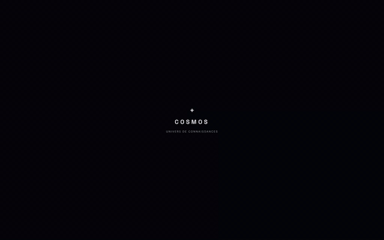
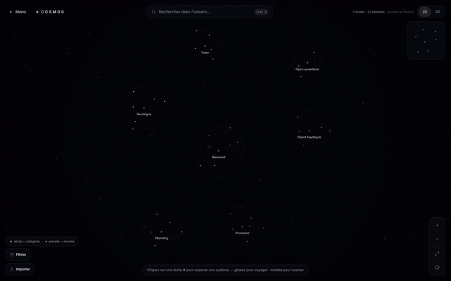

<div align="right">

[🇬🇧 English](../README.md) | 🇫🇷 Français

</div>

<div align="center">


# COSMOS

**Contextual Object Storage & Memory Over Sessions**

[](https://www.python.org/downloads/)
[](https://modelcontextprotocol.io/)


[](LICENSE.md)

<br>

**Ton IA oublie tout entre deux conversations. Coller toutes tes notes dans chaque prompt marche... jusqu'à ce que ça ne marche plus.**

**COSMOS donne à ton assistant une mémoire qui vit en dehors de sa fenêtre de contexte.**

*Créé par Liam DB — avec l'aide de l'IA.*

</div>

---

<div align="center">



*L'application web COSMOS sur un projet d'exemple : une étoile est une catégorie, une planète est un souvenir.*

</div>

---

> COSMOS est un serveur [MCP](https://modelcontextprotocol.io/). Tout assistant capable d'appeler des outils (Claude Desktop, un modèle local...) écrit ses souvenirs dans un fichier SQLite local et ne récupère que les quelques-uns qui comptent pour la question.

<div align="center">
<table>
<tr>
<td align="center" width="16%">

**🧠 Deux couches**<br>
Résumé court toujours<br>
dispo, texte complet<br>
à la demande

</td>
<td align="center" width="16%">

**🔎 Recherche par sens**<br>
Retrouve les questions<br>
reformulées, en<br>
12 langues

</td>
<td align="center" width="16%">

**🏠 100 % local**<br>
Un fichier SQLite,<br>
pas de cloud, pas de compte

</td>
<td align="center" width="16%">

**🗂️ Catégories auto**<br>
Elles grandissent à l'usage,<br>
les prioritaires se chargent<br>
au début de chaque conversation

</td>
<td align="center" width="16%">

**🕸️ Graphe de mémoire**<br>
Liens par thème<br>
et par date

</td>
<td align="center" width="16%">

**🌌 App 2D / 3D**<br>
Ta mémoire comme<br>
un ciel d'étoiles<br>
et de planètes

</td>
</tr>
</table>
</div>

---

## Pourquoi COSMOS

On a comparé COSMOS à l'approche habituelle (coller tout le fichier de notes dans le prompt) sur **8 modèles ouverts** (1,7 à 8 milliards de paramètres), 298 questions par modèle et par configuration, avec environ 200 souvenirs en mémoire.

| | Tout le fichier `.md` dans le prompt | COSMOS |
|---|:---:|:---:|
| Tokens envoyés par question | ≈ 4 750 | **≈ 210** (÷ 23) |
| Temps par réponse | ≈ 7,9 s | **≈ 0,75 s** (÷ 11) |
| Bon souvenir dans le top 3 de la recherche | — | **97 %** (95 % avec 1 700 souvenirs) |
| Modèles où il gagne · égalise · perd | | **4 · 2 · 2** |

COSMOS n'est pas meilleur partout : il perd face au fichier complet sur Llama 3.2 3B et Qwen3.5 4B. Les détails honnêtes, la méthode et les limites sont dans [`benchmark-cosmos/`](../benchmark-cosmos/SUMMARY.md) et sur le [site](https://cosmos.devliam.com). **[Méthodologie complète (PDF, en anglais)](../docs/benchmark-methodology.pdf)** : données, configurations, notation, statistiques et limites.


---

## À quoi ça sert

- **Un assistant personnel qui se souvient de toi :** tes préférences, tes règles, qui est qui, ce que tu as décidé la semaine dernière.
- **Les décisions d'un projet :** pourquoi tu as choisi une base de données, une bibliothèque ou un design, et ce qu'il a remplacé.
- **Un assistant de code qui a du contexte :** tes conventions, tes choix d'architecture, les erreurs récurrentes à éviter.
- **Notes de recherche et d'étude :** des milliers de notes, et l'assistant ne lit que les trois qui correspondent à la question.
- **Modèles locaux et petits :** un modèle de 2 à 8 milliards de paramètres a une fenêtre de contexte courte. COSMOS lui donne une longue mémoire sans remplir cette fenêtre.
- **Connaissances d'équipe** (plusieurs personnes avec un même `cosmos.db`) : pas testé, mais rien ne l'empêche.

---

## Installation

> Prérequis : **Python 3.10+** et **git** (pas de Git ? télécharge le ZIP depuis GitHub).
>
> Testé sur **Windows**. Linux et macOS ne sont pas encore testés. Sur Ubuntu/Debian, `install.py` a d'abord besoin du module `venv` : `sudo apt install python3-venv`.

```bash
git clone https://github.com/DevLiamDb/COSMOS.git
cd COSMOS
python install.py --configure
```

Puis **redémarre Claude Desktop**. C'est tout.

<!-- 📸 AJOUTE TON GIF ICI — enregistre l'installation dans un terminal avec ScreenToGif (Windows) ou asciinema, sauvegarde-le dans assets/install.gif, puis décommente : -->
<!--  -->

`install.py` fait tout à ta place :

1. crée un environnement `.venv`,
2. installe les dépendances,
3. télécharge le modèle de recherche une seule fois (il reste ensuite en cache sur ta machine),
4. avec `--configure`, ajoute COSMOS à Claude Desktop (ton ancienne config est sauvegardée en `claude_desktop_config.json.bak`).

**Tu préfères éditer la config toi-même ?** Lance `python install.py` sans `--configure` : il affiche le bloc à coller dans `claude_desktop_config.json`.

**À propos du modèle de recherche.** COSMOS cherche avec **Polaris**, notre propre modèle (multilingual-e5-small affiné sur des souvenirs écrits pour COSMOS). Polaris est pour l'instant privé sur Hugging Face : sans token, COSMOS **se replie automatiquement sur MiniLM**, qui fonctionne pareil. Si tu y as accès, définis `HF_TOKEN` avant de lancer `install.py`.

---

## Utilisation

### 1. Parle à ton assistant

Une fois branché, Claude voit 22 outils `cosmos_*`. Tu ne les appelles pas toi-même : c'est l'assistant qui le fait.

```
cosmos_write("On migre la base vers PostgreSQL : coût plus bas.")
→ stocké · catégorie : Projet d'exemple · type : decision

cosmos_query("pourquoi a-t-on changé de base ?")
→ Base : passage à PostgreSQL (coût).        ← résumés courts seulement

cosmos_recall(id)
→ Réunion d'équipe : on quitte Firebase pour PostgreSQL à cause du coût...   ← texte complet, à la demande
```

Pour que l'assistant utilise COSMOS tout seul, donne-lui les instructions de [`cosmos-memory.md`](../cosmos-memory.md).

### 2. Catégories prioritaires — le « sac à dos »

Marque une catégorie comme prioritaire (règles, préférences). `cosmos_priority_context()` renvoie tout son contenu en un appel léger, à lancer au début de chaque conversation.

<div align="center">



*Une étoile « Decisions » ouverte dans l'app : sept souvenirs en orbite.*

</div>

### 3. Voir ta mémoire (application web)

```bash
cd webapp
bun install
bun dev
```

Ouvre http://localhost:3000. Recherche avec `Ctrl K`, filtres, édition, bascule 2D / 3D. L'app lit et écrit le même `cosmos.db` que le serveur.

### 4. Tester sans client MCP *(optionnel)*

```bash
set ANTHROPIC_API_KEY=sk-ant-...      # PowerShell : $env:ANTHROPIC_API_KEY="sk-ant-..."
python scripts/chat_with_memory.py
```

Un chat dans le terminal qui utilise COSMOS comme mémoire (il faut ta propre clé API Claude, facturée sur ce compte).

### 5. Lancer les tests *(optionnel)*

```bash
.venv/Scripts/python -m unittest discover -s tests -v
```

Sur Linux ou macOS (pas encore testés), utilise `.venv/bin/python`.

---

## Le modèle d'IA : Polaris

COSMOS contient **un modèle d'IA à lui**, utilisé uniquement pour la recherche. Il n'écrit pas de texte et ne te parle pas : il transforme une phrase en une liste de 384 nombres (un vecteur) pour que deux phrases de même sens se retrouvent proches.

- **Ce que c'est :** Polaris est `multilingual-e5-small` (118 millions de paramètres, licence MIT) affiné par nos soins sur 7 040 souvenirs en 12 langues écrits pour COSMOS. Environ 10 minutes d'entraînement sur 2 GPU Tesla T4.
- **Ce qu'il fait :** une question et chaque souvenir deviennent des vecteurs. Les vecteurs les plus proches sont les meilleures réponses. C'est pour ça que « pourquoi a-t-on changé de base ? » retrouve « on migre vers PostgreSQL ».
- **Où il tourne :** sur ton processeur, au format ONNX, via [fastembed](https://github.com/qdrant/fastembed). Pas de GPU, pas de cloud, pas d'appel d'API. Tes souvenirs ne quittent jamais ta machine.

**Comment COSMOS récupère le modèle**

1. Si un dossier `models/polaris/` existe à côté de `server.py`, COSMOS l'utilise.
2. Sinon il télécharge Polaris une seule fois depuis Hugging Face (`DevLiamDb/polaris`, environ 470 Mo) et le garde en cache. Ensuite ça marche hors ligne.
3. Polaris est pour l'instant **privé**. Si tu y as accès, définis ton token avant l'installation (`HF_TOKEN`, créé sur https://huggingface.co/settings/tokens).
4. Sans accès, COSMOS **se replie sur MiniLM** (`paraphrase-multilingual-MiniLM-L12-v2`, environ 220 Mo, public) et affiche un message. Tout fonctionne quand même.
5. `COSMOS_EMBED_MODEL=minilm` force MiniLM. Si tu changes de modèle, COSMOS réindexe tes souvenirs tout seul.

| Mesure de recherche (sans IA, ~200 souvenirs) | MiniLM | e5-small | **Polaris** |
|---|:---:|:---:|:---:|
| Bon souvenir dans le top 3 | 97,6 % | 96,3 % | **98,3 %** |
| « Pas en mémoire » reconnu | 84,6 % | 84,8 % | **92,0 %** |
| Version la plus récente d'un fait classée en premier | 91,7 % | 91,7 % | 86,1 % |

Il n'est pas devant partout : sur la recherche seule, il classe moins souvent en premier la version la plus récente d'un fait. COSMOS corrige cet ordre ensuite, grâce à la date. Petit jeu de test (~125 questions par tirage) : des écarts de 1 à 2 points restent dans la marge du hasard.

---

<details>
<summary><b>🗂️ Structure des fichiers</b></summary>
<br>

```
COSMOS/
├── install.py            ← installation en une commande ← COMMENCE ICI
├── server.py             ← serveur MCP (22 outils)
├── cosmos/               ← le moteur
│   ├── db.py             ← schéma SQLite (nodes, edges), stockage des embeddings
│   ├── embeddings.py     ← vecteurs sémantiques (Polaris, repli sur MiniLM)
│   ├── summarizer.py     ← résumé « Surface » de chaque souvenir
│   ├── categorize.py     ← catégories automatiques (zero-shot)
│   ├── graph.py          ← CosmosEngine : write, recall, query, link, neighbors...
│   ├── visualize.py      ← graphe HTML interactif autonome
│   └── web_export.py     ← export JSON pour l'app web
├── webapp/               ← app Next.js / Three.js (2D et 3D)
├── scripts/              ← chat terminal avec mémoire
├── tests/                ← suite de tests
├── benchmark/            ← code du benchmark (run, report, données synthétiques)
├── benchmark-cosmos/     ← résultats réels : graphiques, tableaux, réponses brutes
├── training/             ← scripts d'entraînement et d'export de Polaris
├── cosmos-memory.md      ← instructions à donner à ton assistant
├── docs/                 ← documentation détaillée (français)
└── assets/               ← logo et GIFs
```

</details>

---

<details open>
<summary><b>🧰 Les 22 outils — à quoi sert chacun</b></summary>
<br>

Tu ne les appelles jamais toi-même : c'est ton assistant qui le fait. Voici ce que chacun fait concrètement.

**Se souvenir et retrouver**

| Outil | Ce qu'il fait | Exemple concret |
|---|---|---|
| `cosmos_write` | Enregistre un souvenir : texte complet, résumé court, vecteur, catégorie, date | « On a choisi PostgreSQL à cause du coût » est enregistré comme décision |
| `cosmos_query` | Cherche par le sens, renvoie seulement des résumés courts | « pourquoi a-t-on changé de base ? » le retrouve, même avec d'autres mots |
| `cosmos_recall` | Charge le texte complet d'un seul souvenir | Ouvrir toute la note de réunion seulement quand le résumé ne suffit pas |
| `cosmos_neighbors` | Montre les souvenirs liés (même thème, avant et après) | Suivre l'évolution d'une décision dans le temps |
| `cosmos_update_node` | Modifie un souvenir (titre, texte, catégorie) | Un fait a changé : résumé et vecteur de recherche sont recalculés |
| `cosmos_set_pinned` | Épingle un souvenir | Marquer « celui-là compte pour moi » sur une seule planète |

**Organiser**

| Outil | Ce qu'il fait | Exemple concret |
|---|---|---|
| `cosmos_categories` | Liste les catégories et celles qui sont prioritaires | Voir quels thèmes contient ta mémoire |
| `cosmos_set_category_priority` | Marque une catégorie entière comme prioritaire | Garder ta catégorie « règles » toujours disponible |
| `cosmos_priority_context` | Le « sac à dos » : tous les souvenirs prioritaires en un appel léger | À lancer au début de chaque conversation pour que l'assistant connaisse tes règles |
| `cosmos_set_category_color` | Choisit la couleur d'une catégorie | Mettre « Travail » en bleu dans l'app web |
| `cosmos_rename_category` | Renomme une catégorie et ses souvenirs | `regle` devient `regles` |
| `cosmos_merge_categories` | Fusionne une catégorie dans une autre | Regrouper deux catégories quasi identiques |

**Supprimer (irréversible, seulement sur ta demande explicite)**

| Outil | Ce qu'il fait |
|---|---|
| `cosmos_delete_node` / `cosmos_delete_nodes` | Supprime un ou plusieurs souvenirs et leurs liens |
| `cosmos_delete_category` | Supprime une catégorie et tous ses souvenirs |
| `cosmos_delete_session` | Supprime tout ce qui a été écrit pendant une session |
| `cosmos_delete_all` | Vide toute la base (il y a un garde-fou, et aucune sauvegarde) |

**Maintenir et visualiser**

| Outil | Ce qu'il fait | Exemple concret |
|---|---|---|
| `cosmos_status` | Compte les souvenirs, liens et sessions | Vérifier que la mémoire n'est pas vide |
| `cosmos_reindex` | Recalcule tous les vecteurs avec le modèle actuel | Après un changement de modèle de recherche |
| `cosmos_visualize` | Génère un graphe HTML interactif autonome | Partager une image de ta mémoire sans rien installer |
| `cosmos_export_web` | Exporte le graphe pour l'app web | Rafraîchir le ciel 2D / 3D |
| `cosmos_graph_app` | Affiche le graphe en direct dans le chat (il faut un hôte MCP Apps et un serveur distant) | Expérimental |

</details>

---

<details>
<summary><b>⚙️ Comment ça marche à l'intérieur</b></summary>
<br>

```
assistant ──MCP──► server.py ──► CosmosEngine ──► cosmos.db (SQLite)
                                      │
                                      └── Polaris / MiniLM (ONNX, CPU, via fastembed)
```

- **Écrire :** le texte complet est stocké (Abyss), résumé (Surface), transformé en vecteur, catégorisé et daté.
- **Chercher :** la question devient un vecteur, les souvenirs les plus proches reviennent en résumés courts. Les versions récentes d'un fait passent en premier, les anciennes sont signalées comme remplacées.
- **Rappeler :** l'assistant demande le texte complet d'un seul souvenir. Rien d'autre n'entre dans sa fenêtre de contexte.

Si tu changes de modèle d'embedding, COSMOS le détecte à l'ouverture de la base et réindexe tes souvenirs.

La documentation française complète (catégories, routes de l'app web, graphe, limites) est dans [`docs/DETAILS-fr.md`](../docs/DETAILS-fr.md).

</details>

---

<details>
<summary><b>❓ FAQ</b></summary>
<br>

**Où sont mes données ?**
Dans `cosmos.db`, créé à côté de `server.py` au premier lancement. Il ne quitte jamais ta machine. Tu peux l'ouvrir avec n'importe quel client SQLite, le sauvegarder ou le supprimer.

**Il me faut un GPU ou un compte ?**
Non. Polaris tourne sur le CPU. Pas de compte, pas de clé API (sauf pour le chat terminal optionnel).

**Le premier lancement est lent.**
Le modèle de recherche se télécharge une seule fois (environ 220 Mo pour MiniLM, 470 Mo pour Polaris), puis reste en cache.

**Claude ne voit pas les outils.**
Redémarre complètement Claude Desktop après `install.py --configure`. Vérifie que `claude_desktop_config.json` contient bien une entrée `cosmos-engine`.

**J'ai changé de modèle de recherche, j'ai perdu mes souvenirs ?**
Non. COSMOS les réindexe automatiquement à la prochaine ouverture de la base.

**La catégorisation automatique est-elle fiable ?**
Faiblement : 21 à 39 % de bonnes réponses sur notre jeu de test. Tu peux toujours imposer une catégorie avec `node_type` et fusionner les catégories ensuite.

</details>

---

## Histoire & crédits

<details>
<summary><b>📖 Comment COSMOS est né</b></summary>
<br>

COSMOS a commencé comme une **histoire**, pas comme un logiciel.

Liam DB écrivait une histoire et faisait du roleplay avec des IA pour s'imaginer vivre au milieu de modèles d'IA inventés. L'un d'eux avait une **mémoire infinie** : une mémoire qui vivait en dehors du modèle, gardait tout, et ne rendait que ce qui comptait. Dans l'histoire, cette mémoire s'appelait **COSMOS**.

Puis à un moment, l'histoire a cessé d'être seulement une histoire. La question est devenue « est-ce que ça pourrait vraiment exister ? », et c'est devenu un vrai projet, d'abord nommé **Cosmos Engine**, aujourd'hui simplement **COSMOS**.

| | |
|---|---|
| **Naissance** | Vendredi 11 septembre 2026, 12:28:28 |
| **Ancien nom** | Cosmos Engine |
| **Origine** | Un modèle d'IA fictif à mémoire infinie, tiré d'une histoire de roleplay |
| **Aujourd'hui** | Un vrai serveur MCP avec son propre modèle de recherche, Polaris |

</details>

<details>
<summary><b>🙏 Crédits — qui et quoi a fait COSMOS</b></summary>
<br>

COSMOS a été **écrit avec de l'IA, et on le dit franchement.**

| Qui | Rôle |
|---|---|
| **Liam DB** ([DevLiamDb](https://github.com/DevLiamDb)) | Créateur. L'idée, l'histoire derrière, la direction, les décisions, les tests. |
| **[Claude Code](https://claude.com/claude-code)** (Anthropic) | A écrit le code du projet (moteur, serveur MCP, installateur, benchmark, scripts d'entraînement), sous la direction de Liam DB. |
| **Z.ai, modèle GLM 5.3 Flash** | A généré l'interface de l'app web (`webapp/`). |
| **Polaris** | Le modèle de recherche : un affinage de [`intfloat/multilingual-e5-small`](https://huggingface.co/intfloat/multilingual-e5-small). |

Les souvenirs d'entraînement, les questions du benchmark et les textes de test ont aussi été écrits avec de l'IA, pas collectés auprès de vrais utilisateurs.

**Construit sur :** [MCP](https://modelcontextprotocol.io/), [fastembed](https://github.com/qdrant/fastembed), [ONNX Runtime](https://onnxruntime.ai/), [SQLite](https://www.sqlite.org/), [Hugging Face](https://huggingface.co/), [Kaggle](https://www.kaggle.com/) (entraînement et benchmark), [Next.js](https://nextjs.org/) et [Three.js](https://threejs.org/) pour l'app web.

**Retrouver le créateur :** 🌐 [devliam.com](https://devliam.com) · 🐙 [GitHub](https://github.com/DevLiamDb)

La liste complète des modèles, bibliothèques et licences est dans [CREDITS.md](CREDITS.md).

</details>

---

## Licence

**COSMOS Personal Use License v1.0**

✅ Libre d'utilisation : personnel, éducatif, recherche
✅ Modification et partage autorisés, en citant l'auteur d'origine
✅ Tes souvenirs et ton `cosmos.db` t'appartiennent
❌ Interdit de vendre COSMOS sans autorisation écrite
❌ Interdit de se faire passer pour son créateur

Voir [LICENSE.md](LICENSE.md) pour les conditions complètes.

---

<div align="center">

Créé par Liam DB — avec l'aide de l'IA.

</div>
