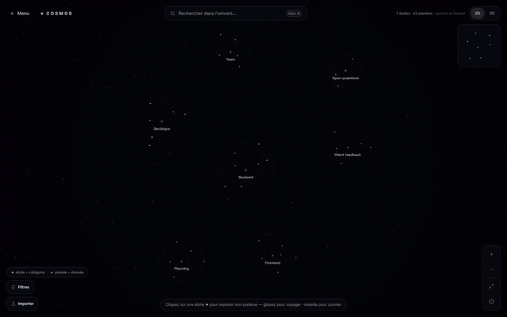

<div align="right">

🇬🇧 English | [🇫🇷 Français](FR/README.md)

</div>

<div align="center">


# COSMOS

**Contextual Object Storage & Memory Over Sessions**

[](https://www.python.org/downloads/)
[](https://modelcontextprotocol.io/)


[](LICENSE)

<br>

**Your AI forgets everything between conversations. Pasting all your notes into every prompt works... until it doesn't.**

**COSMOS gives your assistant a memory that lives outside its context window.**

*Built by Liam DB — with the help of AI.*

</div>

---

<div align="center">


*The COSMOS web app on an example project: a star is a category, a planet is a memory.*

</div>

---

> COSMOS is an [MCP](https://modelcontextprotocol.io/) server. Any assistant that can call tools (Claude Desktop, a local model...) writes its memories into a local SQLite file and gets back only the few that matter for the question.

<div align="center">
<table>
<tr>
<td align="center" width="16%">

**🧠 Two layers**<br>
Short summary always<br>
available, full text<br>
on demand

</td>
<td align="center" width="16%">

**🔎 Search by meaning**<br>
Finds rephrased<br>
questions, in<br>
12 languages

</td>
<td align="center" width="16%">

**🏠 100% local**<br>
One SQLite file,<br>
no cloud, no account

</td>
<td align="center" width="16%">

**🗂️ Auto categories**<br>
They grow with use,<br>
priority ones load<br>
at conversation start

</td>
<td align="center" width="16%">

**🕸️ Memory graph**<br>
Links by topic<br>
and by time

</td>
<td align="center" width="16%">

**🌌 2D / 3D app**<br>
See your memory<br>
as a sky of stars<br>
and planets

</td>
</tr>
</table>
</div>

---

## Why COSMOS

We compared COSMOS with the usual approach (pasting the whole notes file into the prompt) on **8 open models** (1.7B to 8B parameters), 298 questions per model and per setup, with about 200 memories stored.

| | Whole `.md` file in the prompt | COSMOS |
|---|:---:|:---:|
| Tokens sent per question | ≈ 4,750 | **≈ 210** (×23 fewer) |
| Time per answer | ≈ 7.9 s | **≈ 0.75 s** (×11 faster) |
| Right memory in the top 3 of the search | — | **97%** (95% with 1,700 memories) |
| Models where it wins · ties · loses | | **4 · 2 · 2** |

COSMOS is not better everywhere: it loses against the full file on Llama 3.2 3B and Qwen3.5 4B. The honest details, the method and the limits are in [`benchmark-cosmos/`](benchmark-cosmos/SUMMARY.md) and on the [website](https://cosmos.devliam.com). **[Full methodology (PDF)](docs/benchmark-methodology.pdf)**: data, setups, scoring, statistics and limits.

---

## What it's useful for

- **A personal assistant that remembers you:** your preferences, your rules, who is who, what you decided last week.
- **Project decisions:** why you picked a database, a library or a design, and what it replaced.
- **A coding assistant with context:** your conventions, your architecture choices, recurring mistakes to avoid.
- **Research and study notes:** thousands of notes, and the assistant reads only the three that match the question.
- **Local and small models:** a 2 to 8 billion parameter model has a short context window. COSMOS gives it a long memory without filling that window.
- **Team knowledge** (several people sharing one `cosmos.db`): not tested, but nothing prevents it.

---

## Installation

> Requirements: **Python 3.10+** and **git** (no Git? download the ZIP from GitHub).
>
> Tested on **Windows**. Linux and macOS are not tested yet. On Ubuntu/Debian, `install.py` needs the `venv` module first: `sudo apt install python3-venv`.

```bash
git clone https://github.com/DevLiamDb/COSMOS.git
cd COSMOS
python install.py --configure
```

Then **restart Claude Desktop**. That's it.

<!-- 📸 ADD YOUR GIF HERE — record the install in a terminal with ScreenToGif (Windows) or asciinema, save it as assets/install.gif, then uncomment: -->
<!--  -->

`install.py` does everything for you:

1. creates a `.venv` environment,
2. installs the dependencies,
3. downloads the search model once (it then stays cached on your machine),
4. with `--configure`, adds COSMOS to Claude Desktop (your old config is saved as `claude_desktop_config.json.bak`).

**Prefer to edit the config yourself?** Run `python install.py` without `--configure`: it prints the block to paste in `claude_desktop_config.json`.

**About the search model.** COSMOS searches with **Polaris**, our own model (multilingual-e5-small fine-tuned on memories written for COSMOS). Polaris is currently private on Hugging Face: without a token, COSMOS **automatically falls back to MiniLM**, which works the same way. With access, set `HF_TOKEN` before running `install.py`.

---

## Usage

### 1. Talk to your assistant

Once connected, Claude sees 22 `cosmos_*` tools. You don't call them yourself: the assistant does.

```
cosmos_write("We are moving the database to PostgreSQL: lower cost.")
→ stored · category: Example Project · type: decision

cosmos_query("why did we change databases?")
→ Database: switch to PostgreSQL (cost).        ← short summaries only

cosmos_recall(id)
→ Team meeting: we are moving from Firebase to PostgreSQL because of cost...   ← full text, on demand
```

To make the assistant use COSMOS on its own, give it the instructions in [`cosmos-memory.md`](cosmos-memory.md).

### 2. Priority categories — the "backpack"

Mark a category as priority (rules, preferences). `cosmos_priority_context()` returns all of it in one light call, to be run at the start of every conversation.

<div align="center">



*A "Decisions" star opened in the app: seven memories in orbit.*

</div>

### 3. See your memory (web app)

```bash
cd webapp
bun install
bun dev
```

Open http://localhost:3000. Search with `Ctrl K`, filter, edit, switch between 2D and 3D. The app reads and writes the same `cosmos.db` as the server.

### 4. Test it without an MCP client *(optional)*

```bash
set ANTHROPIC_API_KEY=sk-ant-...      # PowerShell: $env:ANTHROPIC_API_KEY="sk-ant-..."
python scripts/chat_with_memory.py
```

A terminal chat that uses COSMOS as its memory (needs your own Claude API key, billed on that account).

### 5. Run the tests *(optional)*

```bash
.venv/Scripts/python -m unittest discover -s tests -v
```

On Linux or macOS (not tested yet), use `.venv/bin/python`.

---

## The AI model: Polaris

COSMOS contains **an AI model of its own**, used for search only. It does not write text and it does not talk to you: it turns a sentence into a list of 384 numbers (a vector) so that sentences with the same meaning end up close to each other.

- **What it is:** Polaris is `multilingual-e5-small` (118 million parameters, MIT license) fine-tuned by us on 7,040 memories in 12 languages written for COSMOS. About 10 minutes of training on 2 Tesla T4 GPUs.
- **What it does:** a question and every memory become vectors. The closest vectors are the best matches. That is why "why did we change databases?" finds "we are moving to PostgreSQL".
- **Where it runs:** on your CPU, in ONNX format, through [fastembed](https://github.com/qdrant/fastembed). No GPU, no cloud, no API call. Your memories never leave your machine.

**How COSMOS gets the model**

1. If a `models/polaris/` folder exists next to `server.py`, COSMOS uses it.
2. Otherwise it downloads Polaris once from Hugging Face (`DevLiamDb/polaris`, about 470 MB) and keeps it in your cache. After that it works offline.
3. Polaris is currently **private**. If you have access, set your token before installing (`HF_TOKEN`, from https://huggingface.co/settings/tokens).
4. Without access, COSMOS **falls back to MiniLM** (`paraphrase-multilingual-MiniLM-L12-v2`, about 220 MB, public) and prints a message. Everything still works.
5. `COSMOS_EMBED_MODEL=minilm` forces MiniLM. If you switch model, COSMOS re-indexes your memories by itself.

| Search measure (no AI, ~200 memories) | MiniLM | e5-small | **Polaris** |
|---|:---:|:---:|:---:|
| Right memory in the top 3 | 97.6% | 96.3% | **98.3%** |
| "Not in memory" recognized | 84.6% | 84.8% | **92.0%** |
| Newest version of a fact ranked first | 91.7% | 91.7% | 86.1% |

It is not ahead everywhere: on search alone it ranks the newest version of a fact first less often. COSMOS fixes that order afterwards using the date. Small test set (~125 questions per draw): gaps of 1 to 2 points are within chance.

---

<details>
<summary><b>🗂️ File structure</b></summary>
<br>

```
COSMOS/
├── install.py            ← one-command installer ← START HERE
├── server.py             ← MCP server (22 tools)
├── cosmos/               ← the engine
│   ├── db.py             ← SQLite schema (nodes, edges), embeddings storage
│   ├── embeddings.py     ← semantic vectors (Polaris, MiniLM fallback)
│   ├── summarizer.py     ← "Surface" summary of each memory
│   ├── categorize.py     ← automatic categories (zero-shot)
│   ├── graph.py          ← CosmosEngine: write, recall, query, link, neighbors...
│   ├── visualize.py      ← standalone interactive HTML graph
│   └── web_export.py     ← JSON export for the web app
├── webapp/               ← Next.js / Three.js app (2D and 3D)
├── scripts/              ← terminal chat with memory
├── tests/                ← test suite
├── benchmark/            ← benchmark code (run, report, synthetic data)
├── benchmark-cosmos/     ← real results: charts, tables, raw answers
├── training/             ← Polaris training and export scripts
├── cosmos-memory.md      ← instructions to give your assistant
├── docs/                 ← detailed documentation (French)
└── assets/               ← logo and GIFs
```

</details>

---

<details open>
<summary><b>🧰 The 22 tools — what each one is for</b></summary>
<br>

You never call these yourself: your assistant does. Here is what each one does in practice.

**Remember and find**

| Tool | What it does | Concrete example |
|---|---|---|
| `cosmos_write` | Saves a memory: full text, short summary, vector, category, date | "We chose PostgreSQL because of cost" is saved as a decision |
| `cosmos_query` | Searches by meaning, returns short summaries only | "why did we change databases?" finds it, even with different words |
| `cosmos_recall` | Loads the full text of one memory | Open the whole meeting note only when the summary is not enough |
| `cosmos_neighbors` | Shows the linked memories (same topic, before and after) | Follow how a decision evolved over time |
| `cosmos_update_node` | Edits a memory (title, text, category) | A fact changed: summary and search vector are recomputed |
| `cosmos_set_pinned` | Pins one memory | Mark "this one matters to me" on a single planet |

**Organize**

| Tool | What it does | Concrete example |
|---|---|---|
| `cosmos_categories` | Lists categories and which ones are priority | See what topics your memory contains |
| `cosmos_set_category_priority` | Marks a whole category as priority | Make your "rules" category always available |
| `cosmos_priority_context` | The "backpack": all priority memories in one light call | Run at the start of every conversation so the assistant knows your rules |
| `cosmos_set_category_color` | Sets the color of a category | Make "Work" blue in the web app |
| `cosmos_rename_category` | Renames a category and its memories | `regle` becomes `rules` |
| `cosmos_merge_categories` | Merges one category into another | Group two near-duplicate categories |

**Delete (irreversible, only on your explicit request)**

| Tool | What it does |
|---|---|
| `cosmos_delete_node` / `cosmos_delete_nodes` | Delete one or several memories and their links |
| `cosmos_delete_category` | Delete a category and all its memories |
| `cosmos_delete_session` | Delete everything written during one session |
| `cosmos_delete_all` | Empty the whole database (there is a safeguard, and no backup) |

**Maintain and visualize**

| Tool | What it does | Concrete example |
|---|---|---|
| `cosmos_status` | Counts memories, links, sessions | Check the memory is not empty |
| `cosmos_reindex` | Recomputes every vector with the current model | After changing the search model |
| `cosmos_visualize` | Builds a standalone interactive HTML graph | Share a picture of your memory without installing anything |
| `cosmos_export_web` | Exports the graph for the web app | Refresh the 2D / 3D sky |
| `cosmos_graph_app` | Shows the graph live in the chat (needs an MCP Apps host and a remote server) | Experimental |

</details>

---

<details>
<summary><b>⚙️ How it works inside</b></summary>
<br>

```
assistant ──MCP──► server.py ──► CosmosEngine ──► cosmos.db (SQLite)
                                      │
                                      └── Polaris / MiniLM (ONNX, CPU, via fastembed)
```

- **Write:** the full text is stored (Abyss), summarized (Surface), turned into a vector, categorized and dated.
- **Query:** the question becomes a vector, the closest memories come back as short summaries. Newer versions of a fact rank first, outdated ones are flagged as replaced.
- **Recall:** the assistant asks for the full text of one memory. Nothing else enters its context window.

If you change the embedding model, COSMOS detects it when the database opens and re-indexes your memories.

The full French documentation (categories, web app routes, graph, limits) is in [`docs/DETAILS-fr.md`](docs/DETAILS-fr.md).

</details>

---

<details>
<summary><b>❓ FAQ</b></summary>
<br>

**Where is my data?**
In `cosmos.db`, created next to `server.py` the first time it runs. It never leaves your machine. You can open it with any SQLite client, back it up or delete it.

**Do I need a GPU or an account?**
No. Polaris runs on the CPU. No account, no API key (except for the optional terminal chat).

**The first launch is slow.**
The search model downloads once (about 220 MB for MiniLM, 470 MB for Polaris), then stays in your cache.

**Claude doesn't see the tools.**
Restart Claude Desktop completely after `install.py --configure`. Check that `claude_desktop_config.json` contains a `cosmos-engine` entry.

**I changed the search model, did I lose my memories?**
No. COSMOS re-indexes them automatically the next time the database opens.

**How reliable is the automatic categorization?**
Weak: 21 to 39% correct on our test set. You can always force a category with `node_type`, and merge categories later.

</details>

---

## Story & credits

<details>
<summary><b>📖 How COSMOS was born</b></summary>
<br>

COSMOS started as a **story**, not as software.

Liam DB was writing a story and playing roleplay with AI to imagine himself living among invented AI models. One of them had **infinite memory**: a memory that lived outside the model, kept everything, and gave back only what mattered. In the story, that memory was called **COSMOS**.

Then at some point the story stopped being only a story. The question became "could this really exist?", and it turned into a real project, first named **Cosmos Engine**, and now simply **COSMOS**.

| | |
|---|---|
| **Born** | Friday 11 September 2026, 12:28:28 |
| **Former name** | Cosmos Engine |
| **Origin** | A fictional AI model with infinite memory, from a roleplay story |
| **Today** | A real MCP server with its own search model, Polaris |

</details>

<details>
<summary><b>🙏 Credits — who and what made COSMOS</b></summary>
<br>

COSMOS was **written with AI, and we say it plainly.**

| Who | Role |
|---|---|
| **Liam DB** ([DevLiamDb](https://github.com/DevLiamDb)) | Creator. The idea, the story behind it, the direction, the decisions, the testing. |
| **[Claude Code](https://claude.com/claude-code)** (Anthropic) | Wrote the code of the project (engine, MCP server, installer, benchmark, training scripts), under Liam DB's direction. |
| **Z.ai, model GLM 5.3 Flash** | Generated the interface of the web app (`webapp/`). |
| **Polaris** | The search model: a fine-tune of [`intfloat/multilingual-e5-small`](https://huggingface.co/intfloat/multilingual-e5-small). |

The training memories, the benchmark questions and the test texts were also written with AI, not collected from real users.

**Built on:** [MCP](https://modelcontextprotocol.io/), [fastembed](https://github.com/qdrant/fastembed), [ONNX Runtime](https://onnxruntime.ai/), [SQLite](https://www.sqlite.org/), [Hugging Face](https://huggingface.co/), [Kaggle](https://www.kaggle.com/) (training and benchmark), [Next.js](https://nextjs.org/) and [Three.js](https://threejs.org/) for the web app.

**Find the creator:** 🌐 [devliam.com](https://devliam.com) · 🐙 [GitHub](https://github.com/DevLiamDb)

The complete list of models, libraries and licenses is in [CREDITS.md](CREDITS.md).

</details>

---

## License

**COSMOS Personal Use License v1.0**

✅ Free to use: personal, educational, research
✅ Modification and sharing allowed, with credit to the original author
✅ Your memories and your `cosmos.db` are yours
❌ Cannot sell COSMOS without written permission
❌ Cannot claim you created it

See [LICENSE](LICENSE) for the full terms.

---

<div align="center">

Built by Liam DB — with the help of AI.

</div>
